# Mantenimiento IPF

**TP N° 3 — Permisos móviles: Android, iOS y Expo** · Taller Complementario – React Native II · Instituto Politécnico Formosa
Alumno: Fabricio Augusto

App para que alumnos y docentes **reporten desperfectos del edificio** (una luz quemada, una canilla que pierde, un proyector roto) y reciban un aviso cuando se resuelven. Usa **cámara**, **ubicación** y **notificaciones**, siempre pedidas en contexto y con una alternativa para cada caso, y elige fotos **sin pedir permiso de galería**.

- Expo **SDK 57** (React Native 0.86) · TypeScript · Expo Router
- Respuestas de las Partes A a F: [RESPUESTAS.md](RESPUESTAS.md)

## Cómo correrla

```bash
npm install
npx expo start            # Expo Go (escaneá el QR)

# Development build (para ver los textos de propósito y blockedPermissions)
npx expo install expo-dev-client
npx expo run:android      # o: npx eas-cli@latest build --profile development --platform android
```

Comandos de verificación: `npx tsc --noEmit`, `npx expo lint` y `npx expo-doctor` (21/21 checks).

## Árbol de carpetas

```
src/
├── app/                              ← rutas (Expo Router)
│   ├── _layout.tsx                   Stack raíz + handler de notificaciones
│   ├── (tabs)/                       grupo: no agrega segmento a la URL
│   │   ├── _layout.tsx               Tabs: Reportes · Avisos · Permisos
│   │   ├── index.tsx                 /                    Inicio: mis reportes
│   │   ├── avisos.tsx                /avisos              Bandeja de avisos
│   │   └── permisos.tsx              /permisos            Panel de permisos
│   ├── reporte/
│   │   ├── nuevo.tsx                 /reporte/nuevo       Formulario
│   │   ├── escanear.tsx              /reporte/escanear    QR (useCameraPermissions, 4 estados)
│   │   ├── foto.tsx                  /reporte/foto        Sacar foto / elegir de la galería
│   │   ├── ubicacion.tsx             /reporte/ubicacion   Ubicación o sector a mano
│   │   └── [id].tsx                  /reporte/[id]        Detalle + "Simular resolución"
│   ├── permisos/
│   │   └── [recurso].tsx             /permisos/[recurso]  Pantalla previa (presentation: "modal")
│   └── ajustes-app.tsx               /ajustes-app         Interruptor de notificaciones
├── components/
│   ├── PantallaPrevia.tsx            beneficio + "Continuar" | "Abrir Ajustes"
│   ├── ui.tsx                        Pantalla, Boton, Tarjeta, Chip, Campo, Opciones, Cargando
│   └── themed-text.tsx · themed-view.tsx
├── hooks/
│   ├── usePermiso.ts                 hook unificado: estado, parcial, pedir(), abrirAjustes()
│   ├── useConPermiso.ts              pedido en contexto: pantalla previa → acción
│   ├── useRevisarAlVolver.ts         AppState: re-consulta al volver de Ajustes
│   └── use-theme.ts · use-color-scheme.ts
├── lib/
│   ├── permisos.ts                   fuentes get/request por recurso, interpretar(), textos
│   ├── notificaciones.ts             canal "reportes", handler, simularResolucion()
│   ├── ubicacion.ts                  obtenerUbicacion() con aproximada (Android + iOS)
│   └── store.ts                      reportes, avisos y borrador (useSyncExternalStore)
└── constants/theme.ts
```

`/permisos` (pestaña) y `/permisos/[recurso]` (modal) conviven: la primera vive dentro del grupo `(tabs)`, que no suma segmento a la URL, y la segunda está en la carpeta `permisos/` del Stack raíz, así se presenta como modal por encima de las pestañas.

## Cómo funciona el hook `usePermiso`

```ts
const { estado, parcial, respuesta, pedir, abrirAjustes } = usePermiso('ubicacion');
// estado: 'cargando' | 'concedido' | 'preguntable' | 'bloqueado'
```

La decisión clave está en [`interpretar()`](src/lib/permisos.ts):

```ts
if (r === null) return 'cargando';     // primer render: todavía no respondió el sistema
if (r.granted) return 'concedido';
if (r.canAskAgain) return 'preguntable'; // → botón "Continuar"
return 'bloqueado';                      // → botón "Abrir Ajustes"
```

- **Nunca guarda el permiso "para siempre"**: vuelve a consultar con `get…PermissionsAsync()` al montar, al volver a enfocar la pantalla (por ejemplo, al cerrar el modal previo) y al volver de Ajustes (`AppState`, en [useRevisarAlVolver](src/hooks/useRevisarAlVolver.ts)).
- `parcial` es `true` con ubicación aproximada (`android.accuracy === 'coarse'` / `ios.accuracy === 'reduced'`), fotos limitadas (`accessPrivileges === 'limited'`) o notificaciones provisionales (`ios.status === PROVISIONAL`).
- `pedir()` no llama a `request…()` si ya está bloqueado (evita el bucle de pedidos que responden al instante).
- [`useConPermiso`](src/hooks/useConPermiso.ts) implementa "no insistir": si falta el permiso abre `/permisos/[recurso]`; al volver, ejecuta la acción solo si se concedió. Si se denegó, la pantalla previa no vuelve a aparecer sola, solo cuando la persona toca otra vez la función.

## Tabla de permisos

| Recurso | Módulo | Cuándo se pide | Alternativa si se deniega |
|---|---|---|---|
| Cámara (escanear QR) | `expo-camera` · `useCameraPermissions` | Al tocar "Escanear QR" en el formulario (pantalla previa → diálogo). | Escribir el código del aula a mano. |
| Cámara (sacar foto) | `expo-image-picker` · `launchCameraAsync` | Al tocar "Sacar foto". | Elegir una foto con el selector del sistema. |
| Fotos (galería) | `expo-image-picker` · `launchImageLibraryAsync` | **Nunca**: el selector del sistema no necesita permiso. | — |
| Ubicación (primer plano) | `expo-location` · `requestForegroundPermissionsAsync` | Al tocar "Usar mi ubicación actual". | Elegir el sector a mano (patio, pasillo, estacionamiento…). Si es aproximada, se muestra "Ubicación aproximada" en lugar de coordenadas. |
| Notificaciones | `expo-notifications` · `requestPermissionsAsync` | **Solo** al activar el interruptor de `/ajustes-app` (antes se crea el canal `reportes` en Android). | Los avisos siempre quedan en la bandeja `/avisos`. |

Ningún permiso denegado impide crear un reporte: el único dato obligatorio es el título, más el aula **o** el sector.

## `app.json`: bloque `plugins` comentado

> JSON no admite comentarios; este bloque es igual al de [app.json](app.json) con anotaciones.

```jsonc
"plugins": [
  "expo-router",
  ["expo-splash-screen", { /* … */ }],
  [
    "expo-camera",
    {
      // NSCameraUsageDescription. Molde "Usamos tu [dato] para [beneficio concreto]"
      "cameraPermission": "Usamos tu cámara para leer el QR de la puerta del aula y sacar la foto del desperfecto que reportás.",
      // Mínimo privilegio: escanear un QR no graba audio.
      "microphonePermission": false, // iOS: no agrega NSMicrophoneUsageDescription
      "recordAudioAndroid": false,   // Android: no declara RECORD_AUDIO
      "barcodeScannerEnabled": true  // necesario para leer el QR
    }
  ],
  [
    "expo-location",
    {
      // NSLocationWhenInUseUsageDescription
      "locationWhenInUsePermission": "Usamos tu ubicación para marcar en qué parte del instituto está el problema que reportás.",
      // Solo primer plano: sin ACCESS_BACKGROUND_LOCATION ni UIBackgroundModes ni servicio en primer plano.
      "isAndroidBackgroundLocationEnabled": false,
      "isIosBackgroundLocationEnabled": false,
      "isAndroidForegroundServiceEnabled": false
    }
  ],
  [
    "expo-image-picker",
    {
      // NSPhotoLibraryUsageDescription (el selector PHPicker no la usa, pero la librería la referencia).
      "photosPermission": "Usamos tus fotos solo para adjuntar al reporte la imagen del desperfecto que elijas.",
      "cameraPermission": "Usamos tu cámara para sacar la foto del desperfecto que reportás.",
      "microphonePermission": false  // no grabamos video: sin micrófono ni RECORD_AUDIO
    }
  ],
  [
    "expo-notifications",
    { "color": "#1e3a8a" }  // color del ícono en la bandeja de Android
  ]
]
```

### `android.blockedPermissions` (justificación)

| Permiso bloqueado | Quién lo agregaría | Por qué no lo usamos |
|---|---|---|
| `RECORD_AUDIO` | `expo-camera`, `expo-image-picker` | No grabamos video ni audio. |
| `ACCESS_BACKGROUND_LOCATION` | `expo-location` (si se habilitara) | La ubicación solo se usa con la pantalla abierta. |
| `READ_MEDIA_IMAGES` | `expo-image-picker` / `expo-media-library` | Las fotos se eligen con el selector del sistema, sin acceso a la galería (Google Play lo restringe). |
| `READ_MEDIA_VIDEO` | ídem | No se adjuntan videos. |
| `READ_MEDIA_AUDIO` | ídem | No se usan archivos de audio. |
| `READ_MEDIA_VISUAL_USER_SELECTED` | ídem | Acceso parcial de Android 14: innecesario con el selector. |
| `READ_EXTERNAL_STORAGE` | `expo-image-picker`, `expo-file-system` | Permiso viejo (≤ Android 12); el selector devuelve una URI propia. |
| `WRITE_EXTERNAL_STORAGE` | `expo-image-picker`, `expo-file-system` | No guardamos archivos en el almacenamiento compartido. |
| `SYSTEM_ALERT_WINDOW` | algunas librerías / depuración | La app nunca dibuja sobre otras apps. |

## Auditoría del manifiesto (desafío opcional)

Salida de `npx expo prebuild --platform android --clean` → `android/app/src/main/AndroidManifest.xml`, más los permisos que se mezclan al compilar desde los manifiestos de cada librería:

| Permiso | Quién lo agrega | ¿En el APK final? |
|---|---|---|
| `INTERNET` | plantilla Expo / `expo-file-system` (Metro, red) | Sí (de instalación) |
| `VIBRATE` | plantilla Expo | Sí (de instalación) |
| `CAMERA` | `expo-camera`, `expo-image-picker` | Sí: escáner y "Sacar foto" |
| `ACCESS_COARSE_LOCATION` | `expo-location` | Sí |
| `ACCESS_FINE_LOCATION` | `expo-location` | Sí (la persona puede elegir "Aproximada") |
| `POST_NOTIFICATIONS` | `expo-notifications` (manifiesto de la librería) | Sí: avisos de "reporte resuelto" |
| `RECEIVE_BOOT_COMPLETED` | `expo-notifications` | Sí (re-programa notificaciones tras reiniciar; de instalación) |
| `RECORD_AUDIO` | `expo-camera`, `expo-image-picker` | **No**: `tools:node="remove"` |
| `ACCESS_BACKGROUND_LOCATION` | — | **No**: `tools:node="remove"` |
| `READ_EXTERNAL_STORAGE` / `WRITE_EXTERNAL_STORAGE` | `expo-image-picker`, `expo-file-system` | **No**: `tools:node="remove"` |
| `READ_MEDIA_IMAGES` / `VIDEO` / `AUDIO` / `VISUAL_USER_SELECTED` | — | **No**: `tools:node="remove"` |
| `SYSTEM_ALERT_WINDOW` | — | **No**: `tools:node="remove"` |

## Desafíos opcionales

- [x] **Auditoría del manifiesto** (arriba).
- [x] **Bloqueo por plataforma:** la pantalla previa en estado bloqueado muestra el camino exacto en Ajustes para Android o iOS según `Platform.OS` ([src/lib/permisos.ts](src/lib/permisos.ts), `TEXTOS[recurso].ajustes`).
- [~] **Notificaciones provisionales:** el panel `/permisos` y `/ajustes-app` detectan y muestran el estado `PROVISIONAL` (`ios.status`). El pedido usa el diálogo normal, porque el interruptor es un pedido explícito.
- [ ] Nota de voz con `expo-audio`.

## Capturas

> Estas capturas son de la **versión web** de la app (`npx expo start --web`), abierta en el navegador con tamaño de celular. Muestran las mismas pantallas y la misma lógica de permisos, pero los permisos los maneja el navegador:
> - La cámara es la cámara de prueba del navegador.
> - En "cargando" se demoró la consulta del permiso para que se llegue a ver.
> - El "después de Ajustes" se simuló cambiando el permiso y haciendo que la app pase a segundo plano y vuelva.
>
> **Faltan, y se sacan en el celular:** escáner **bloqueado** (en web, `expo-camera` siempre devuelve `canAskAgain: true`), **notificación recibida** (no hay notificaciones locales en web) y el **diálogo del sistema con el texto de propósito** (requiere una development build).

| Inicio | Escáner: cargando | Escáner: preguntable | Escáner: concedido |
|---|---|---|---|
| 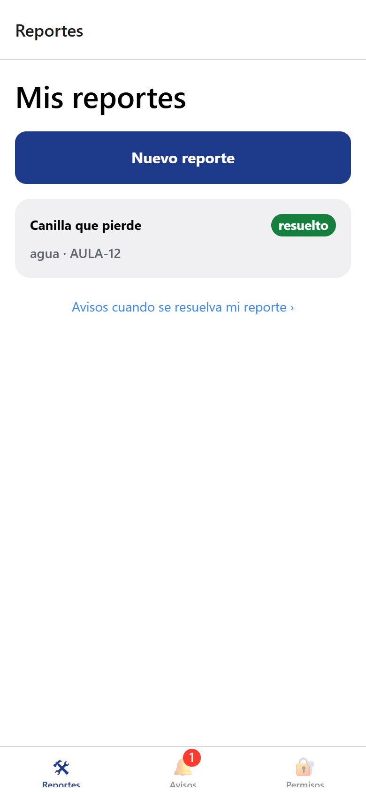 | 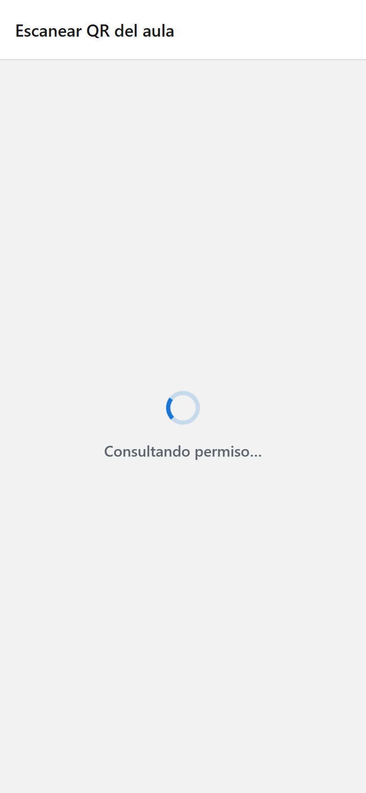 | 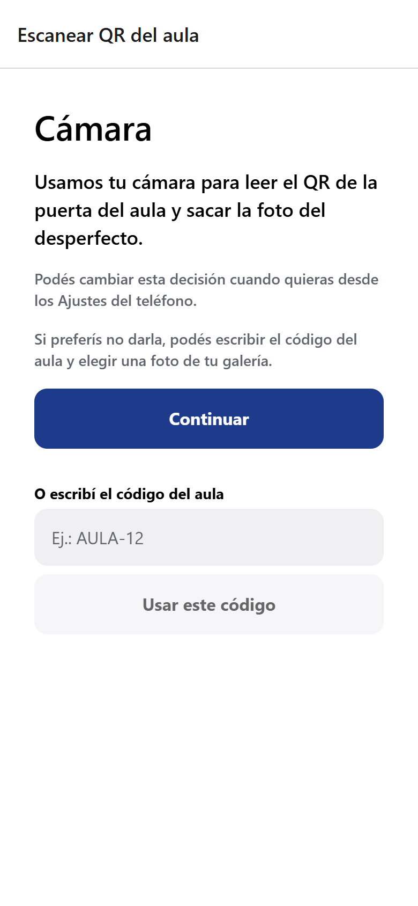 | 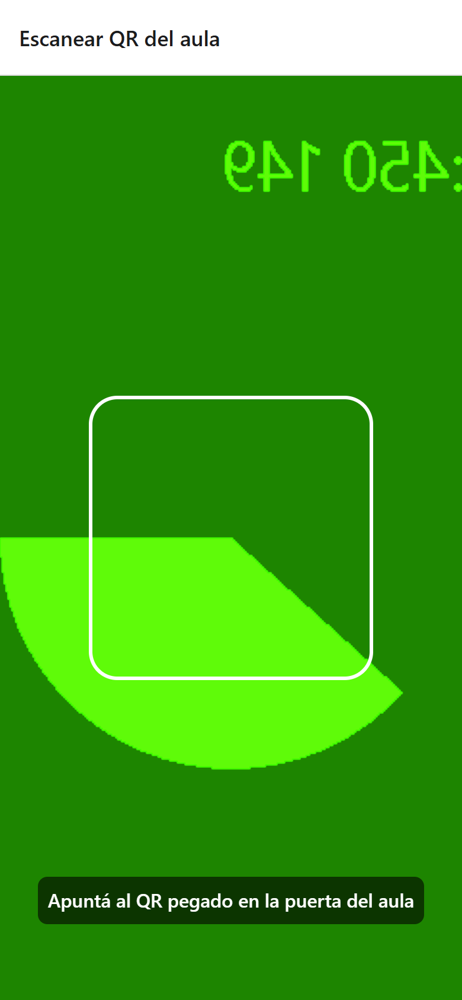 |

| Pantalla previa (modal) | Ubicación concedida | Ubicación denegada → sector a mano | Foto desde el selector |
|---|---|---|---|
| 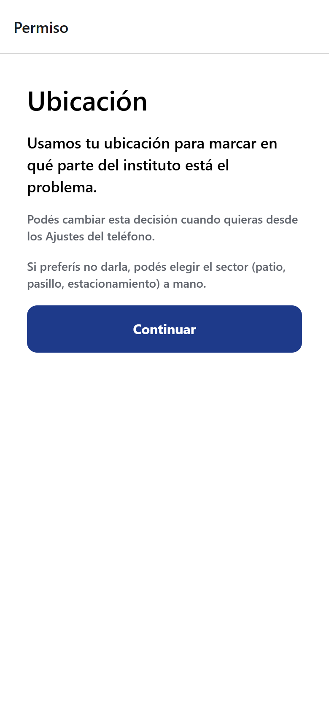 | 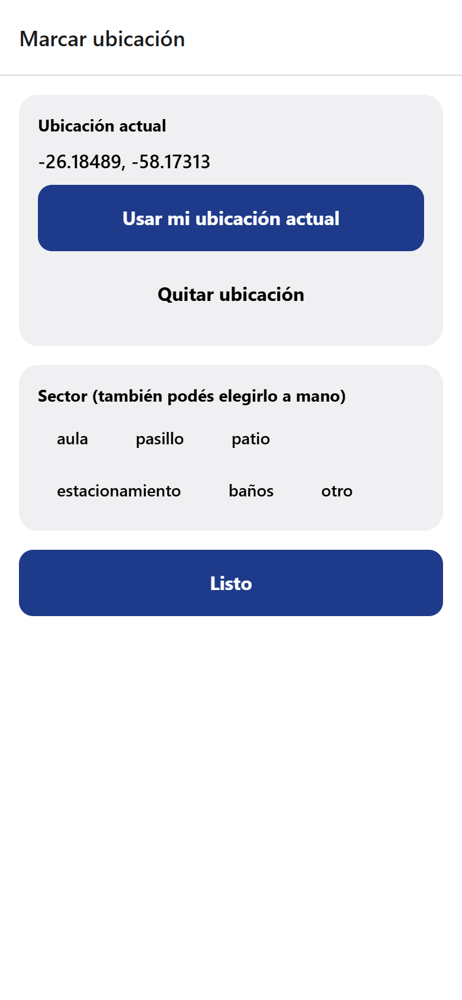 | 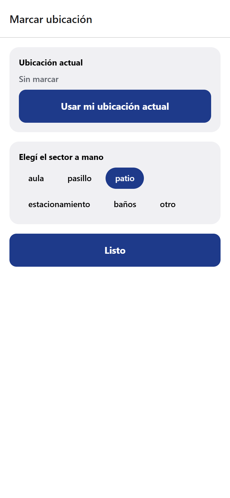 | 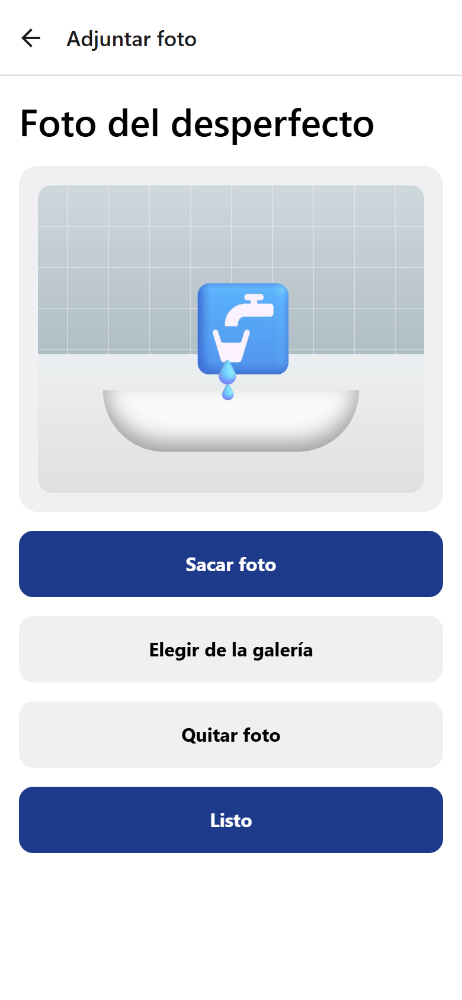 |

| Reporte resuelto (sin notificaciones) | Bandeja de avisos | Panel antes de Ajustes | Panel después de Ajustes |
|---|---|---|---|
| 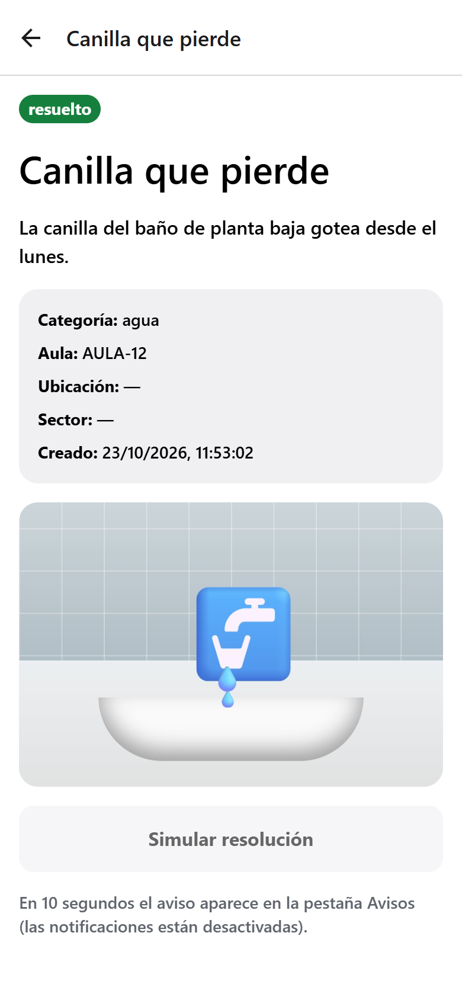 | 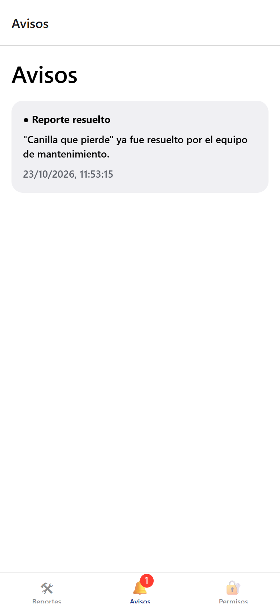 | 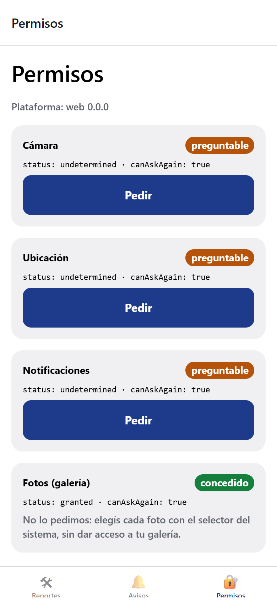 | 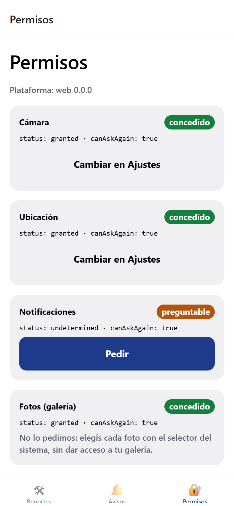 |

## Notas para la defensa

1. **"Continuar" vs "Abrir Ajustes":** [PantallaPrevia.tsx](src/components/PantallaPrevia.tsx) y [`interpretar()`](src/lib/permisos.ts). Lo decide `canAskAgain`.
2. **Revocar la cámara con la app abierta:** Android mata el proceso. Al volver, la app arranca de nuevo y `usePermiso` / `useCameraPermissions` consultan al montar. Si la persona *concede* en Ajustes (eso no mata el proceso), `useRevisarAlVolver` re-consulta con `AppState`.
3. **Elegir foto sin permiso, sacarla con permiso:** el selector del sistema entrega solo la foto que la persona eligió. La cámara, en cambio, captura el entorno en vivo.
4. **Ubicación aproximada:** se muestra "Ubicación aproximada" sin coordenadas. Si se deniega, se carga el sector a mano.
5. **Textos de propósito en Expo Go:** Expo Go es otra app con su propio `Info.plist` y manifiesto; los plugins de `app.json` solo se aplican al compilar tu binario.
6. **Nota de voz por OTA:** no alcanza. Agregar `NSMicrophoneUsageDescription` y `RECORD_AUDIO` cambia el binario nativo, así que hace falta una build nueva.

> El estado de la app (reportes y avisos) se guarda en memoria y se pierde al cerrar la app. Para el TP alcanza; en producción se usaría almacenamiento persistente o un backend.
